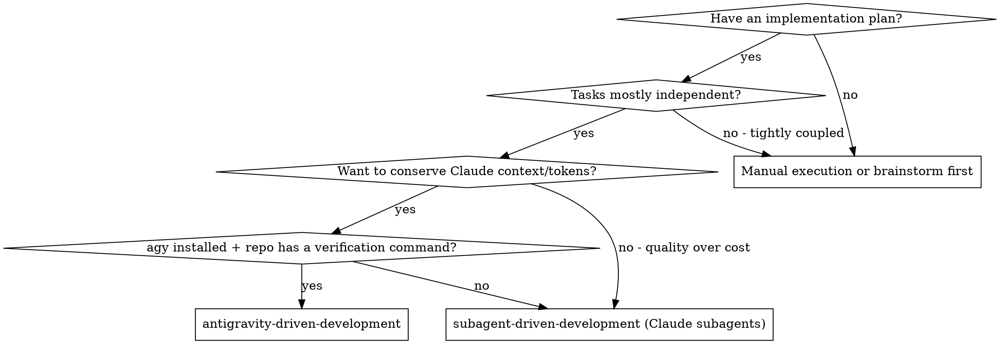
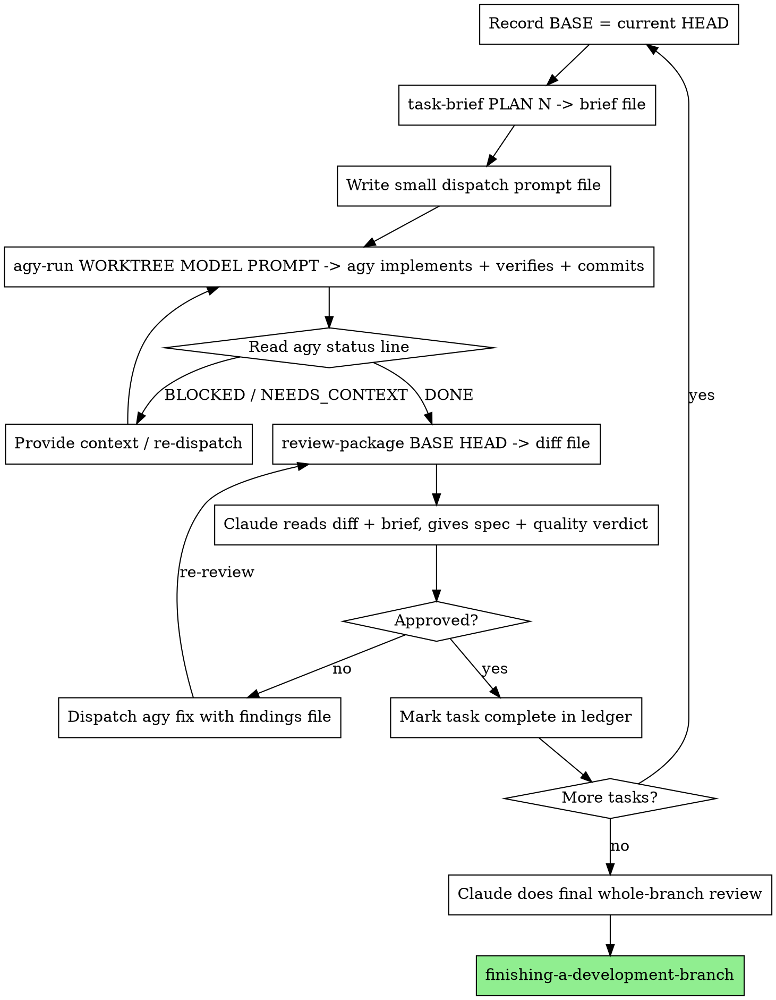

# Antigravity-Driven Development

Execute a plan where **Claude is the controller and reviewer** and the
**antigravity CLI (`agy`) is the implementer**. agy does the grunt work - reading
the codebase, writing code, running the verification loop - using Gemini (or
other agy models). Claude holds the plan, coordinates, and gates quality. Work
moves between them as **files**, so almost nothing agy touches enters Claude's
context.

This is `superpowers:subagent-driven-development` with the implementer swapped
from a Claude Code subagent to `agy -p`. The structure, the per-task review gate,
the file-handoff discipline, and the final whole-branch review are all the same -
read that skill for the deep rationale. This skill documents only what changes
when the implementer is agy.

**Core principle:** Fresh agy dispatch per task + a verification loop agy must
pass + Claude reviews each task's diff + a broad final review = quality work with
the heavy context cost paid in agy's tokens, not Claude's.

## How this saves Claude context

Every byte you paste into a dispatch, and every byte a worker prints back, stays
resident in Claude's context for the rest of the session. The saving is entirely
mechanical, and it only works if you keep the discipline:

- agy reads its **task brief** and **role doc** from files (Claude never pastes
  the task text through its own context - `scripts/task-brief` extracts it via
  bash).
- agy explores the codebase, writes code, and runs tests **inside the worktree**.
  None of that reading or output reaches Claude.
- agy writes its **full report to a file** and prints only its short status block
  (plus a little streamed narration) to stdout - never the full report. That
  short tail is all `scripts/agy-run` returns to Claude.
- Claude reviews by reading the **diff package file** once (one bounded Read),
  not by holding agy's working context.

If you instead paste the plan into the prompt or let agy print its full report to
stdout, you lose the saving. The files are the mechanism.

## When to Use

**Use agy as implementer when** tasks are mechanical-to-moderate, well-specified,
and have a runnable verification command. **Keep Claude subagents** (the original
skill) for tasks needing deep cross-codebase judgment in the implementer itself,
or when there is no test/build loop to catch agy's mistakes.

## Setup (once per run)

1. **Isolated worktree (REQUIRED).** Use `superpowers:using-git-worktrees`. agy
   runs with `--dangerously-skip-permissions` so the loop is hands-off; the
   worktree is what bounds the blast radius. Never run this loop directly on
   `main`/`master`.
2. **Confirm agy is ready AND the model is reachable (do not skip).** Run
   `agy models`, then a real tool-use smoke test from the worktree:
   `agy -p "Create a file smoke.txt containing ok, then print DONE." --model "<MODEL>" --dangerously-skip-permissions`
   - it must create the file and print `DONE`. A model whose quota is exhausted
   produces the **single worst failure mode of this skill**: agy hangs or returns
   empty with **no error on stdout**, writes nothing, and the loop stalls
   silently. The real error is only in `~/.gemini/antigravity-cli/cli.log`
   (`RESOURCE_EXHAUSTED (code 429): Individual quota reached`). Gemini's free
   tier has a weekly per-account quota that resets ~7 days out once hit - verified
   in testing. If the smoke test doesn't create the file, switch models before
   starting (see Troubleshooting).
3. **Pick the verification command** for this repo (e.g. `npm test`, `pytest`,
   `make check`). Every task dispatch names it. No verification command → use the
   original Claude-subagent skill instead; agy without a test loop is unreliable.
4. **Read the plan once, note global constraints, create todos and a ledger** (see
   Durable Progress). Do the same pre-flight plan scan as the original skill.

## The Process

## Dispatching agy

Per task:

1. **Record BASE:** `git -C WORKTREE rev-parse HEAD` - the commit before this
   task. Diff against this, never `HEAD~1` (agy may commit several times).
2. **Brief:** `scripts/task-brief PLAN_FILE N` → brief file path (bash, never
   through context).
3. **Compose a small dispatch prompt file** from `agy-implementer-prompt.md`:
   the brief path, the report path, one or two lines of scene-setting, and the
   exact verification command. Keep it small - the requirements live in the brief.
4. **Dispatch:** `scripts/agy-run WORKTREE MODEL PROMPT_FILE`. agy explores,
   implements, runs the verification command, commits, writes its report file,
   and prints a short status. That status is all Claude sees.

agy runs **non-interactively** - it cannot ask questions mid-task. The
implementer prompt tells it to explore first and to STOP-and-report rather than
guess on ambiguity. Surface ambiguity through the status, not a live exchange.

**Print mode is slow - give it room.** Each agy turn carries planner overhead, so
even a small task (write two files, run tests, commit) routinely takes several
minutes. `agy-run` sets `--print-timeout 20m`; do not wrap it in a short watchdog
and do not kill it at the first quiet minute - a premature kill discards work agy
was about to commit (verified: a task killed at 300s had already written correct,
passing code but had not yet committed). A genuinely stuck run is almost always
quota (see Troubleshooting), not slowness.

**agy's stdout includes its narration**, not only the final status block - it
streams its reasoning ("Files exist, let me run the tests…") then prints the
`Status:` block last. The **report file is the authoritative detail**; read the
`Status:` block at the tail of stdout to route, and open the report only when you
need more than the status.

## Verification loop (the reliability lever)

An autonomous agy is only as trustworthy as the loop that checks it. Every
dispatch names a verification command; agy must run it and make it pass before
committing, and paste the result into its report. If agy cannot make it pass it
must report BLOCKED with the failing output - never commit broken work. This is
non-negotiable and is the main thing standing between "agy did the grunt work"
and "agy confidently wrote something that doesn't run."

## Handling agy's status

agy prints one of four statuses (same contract as the original skill):

- **DONE** - generate the review package (`scripts/review-package BASE HEAD`) and
  review it.
- **DONE_WITH_CONCERNS** - read the concerns. Correctness/scope concerns: address
  before review. Observations: note and proceed.
- **NEEDS_CONTEXT** - agy lacked information. Provide it in the next dispatch and
  re-run. Because there is no interactive channel, expect this more often than
  with a Claude subagent - answer it in the prompt file, not a chat turn.
- **BLOCKED** - assess: context problem → add context, re-dispatch same model;
  needs more reasoning → re-dispatch a more capable agy model (e.g. step up to
  `Gemini 3.1 Pro (High)`); too large → split; plan is wrong → escalate to the human.

Never force the same model to retry unchanged. If agy got stuck, something must change.

## Claude reviews each task

Claude (not agy) runs the per-task quality gate - this is where Claude's judgment
earns its context cost. Read the **diff package file** and the **brief**, then
return two verdicts. Do this directly; do not paste the diff into a sub-prompt.

**Part 1 - Spec compliance:** Missing (skipped/claimed-not-done), Extra
(unrequested, over-engineering), Misunderstood (right feature built wrong). If a
requirement lives in unchanged code or spans tasks, mark it ⚠️ and resolve it
yourself before completing the task - you hold the cross-task context.

**Part 2 - Code quality:** clean separation, real error handling, DRY without
premature abstraction, edge cases; tests verify real behavior (not mocks) and
output is pristine; each file has one responsibility; this change didn't bloat
files. Cite `file:line` for every finding.

**Calibrate severity.** Important = cannot be trusted until fixed (wrong/fragile
behavior, missed requirement, swallowed errors, tests that assert nothing,
verbatim logic duplication). Coverage-could-be-broader and polish are Minor.
Don't trust the report's rationales - judge the code on its merits. A
plan-mandated finding is the human's call: present the finding beside the plan
text and ask which governs.

The full rubric is the original skill's `task-reviewer-prompt.md` - apply it
yourself instead of dispatching it to a subagent.

## Fix loop

Dispatch agy to fix Critical/Important findings (Minor goes in the ledger for the
final review to triage). Write the findings to a file; re-dispatch agy pointed at
that file + the diff (see `agy-implementer-prompt.md` → Fix dispatches). The fix
contract is the same: re-run the verification command over the changed code and
put the result in the report. Confirm the report shows command + output before
re-reviewing. Then re-run `review-package` for the new range and review again.

## Final whole-branch review

After all tasks, Claude does one broad review of the whole branch - this is a
judgment task, so Claude does it directly rather than handing it to agy. Generate
`scripts/review-package MERGE_BASE HEAD` (`MERGE_BASE = git merge-base main HEAD`)
and review the package against the plan and the accumulated Minor findings, using
`superpowers:requesting-code-review`'s rubric. If it returns findings, dispatch
ONE agy fix with the complete list - not one fixer per finding. Then
`superpowers:finishing-a-development-branch`.

## Model selection (agy models)

Use the cheapest agy model that can do the job - the whole point is to spend
agy's cheap tokens, not Claude's. Run `agy models` for the current list; as of
writing:

| Task shape | agy model |
|---|---|
| Transcription / single-file mechanical (brief contains the code) | `Gemini 3.5 Flash (Low)` or `(Medium)` |
| Standard implementation from prose, 1–2 files | `Gemini 3.5 Flash (High)` |
| Multi-file integration, pattern-matching, debugging | `Gemini 3.1 Pro (Low)` → `(High)` |
| BLOCKED retry that needs more reasoning | step up one tier |

agy also exposes Claude Sonnet/Opus - reserve those for a task that genuinely
needs Claude-level reasoning but that you still want to keep **off the main
session's context**. For ordinary grunt work, Gemini is the point.

**Turn count beats token price:** the cheapest model that takes 3× the turns
costs more overall. Use a mid-tier model as the floor for implementers working
from prose; drop to the cheapest tier only when the brief contains the code to
transcribe.

## Durable Progress

Conversation memory does not survive compaction; the ledger does.

- At skill start: `cat "$(git rev-parse --show-toplevel)/.antigravity-sdd/progress.md"`.
  Tasks marked complete are DONE - resume at the first that isn't. Don't
  re-dispatch completed work.
- On a clean review, append one line:
  `Task N: complete (commits <base7>..<head7>, agy=<model>, review clean)`.
- After compaction, trust the ledger and `git log` over recollection. The commits
  it names exist in git even when your context no longer remembers agy creating them.

## File Handoffs

Same discipline as the original skill, applied to agy:

- **Brief:** `scripts/task-brief PLAN N` → file agy reads first.
- **Dispatch prompt:** small file (brief path + report path + scene-setting +
  verification command), passed to `agy-run`. No pasted plan text, no pasted
  prior-task history.
- **Report:** agy writes the full report to `…/task-N-report.md`; prints only status.
- **Diff package:** `scripts/review-package BASE HEAD` → file Claude reads once.
- **Findings:** write fix findings to a file agy reads; don't paste them into the prompt.

## Troubleshooting

**agy ran a long time and produced nothing (no files, no commit, empty/❓
status).** Almost always model quota. Check the tail of
`~/.gemini/antigravity-cli/cli.log` for `RESOURCE_EXHAUSTED (code 429): Individual
quota reached` / `model unreachable`. The planner-loop line `PlannerResponse
without ModifiedResponse encountered` is **normal chatter** - it appears on
successful runs too, so it is not the signal; the 429 is. Fix: switch to a model
with available quota and re-dispatch.

**Model reachability ladder (verified in testing):**
- **Gemini** models are the cost-optimal workhorse, but the free tier's weekly
  per-account quota, once exhausted, 429s every call until it resets (~7 days).
- **GPT-OSS 120B** completed simple single-file writes but looped on a
  multi-step (read brief → write 2 files → run tests → commit) task - treat it as
  a fallback for mechanical work, not multi-step.
- **Claude Sonnet 4.6 / Opus 4.6 via agy** reliably drove the full multi-step
  loop end-to-end. They cost Anthropic tokens, but on a **separate account from
  your main Claude session** - so they still keep the work off your session's
  context. Use them when Gemini is quota-blocked or the task is genuinely multi-step.

**agy wrote files but didn't commit.** It was probably killed (timeout/watchdog)
before the commit step. Don't `git add` the orphaned changes yourself - re-dispatch
the same task; agy detects the existing files, verifies, and commits.

## Red Flags

**Never:**
- Start the loop without the model-reachability smoke test (step 2) - a
  quota-blocked model fails silently and you'll waste the run.
- Kill an agy dispatch at the first quiet minute. Print mode is slow; a true
  stall is quota, diagnosable in the log - not a reason to shorten the timeout.
- Run the loop on `main`/`master`, or without a git worktree.
- Dispatch agy without a verification command in the prompt.
- Let agy commit work whose verification command failed (that's a BLOCKED, not a DONE).
- Paste the plan, the task text, or prior-task summaries into the dispatch prompt
  (it defeats the whole context saving - hand over the brief file instead).
- Let agy print its full report to stdout (report goes to a file; only status returns).
- Skip Claude's per-task review, or accept a task with open Critical/Important findings.
- Diff with `HEAD~1` (use the recorded BASE - agy may make several commits).
- Force the same agy model to retry a BLOCKED task unchanged.
- Re-dispatch a task the ledger already marks complete (check ledger + `git log` after compaction).
- Let agy push, or touch any branch but the worktree's.

## Integration

**Required:**
- **superpowers:using-git-worktrees** - isolated workspace agy runs in.
- **superpowers:subagent-driven-development** - the parent skill; full rationale
  for the per-task gate, file handoffs, and pre-flight scan.
- **superpowers:requesting-code-review** - rubric for the final whole-branch review.
- **superpowers:finishing-a-development-branch** - complete the branch after all tasks.

**Prompt templates / scripts (this skill):**
- [agy-implementer-prompt.md](agy-implementer-prompt.md) - the agy dispatch template.
- `scripts/agy-run` - dispatch grunt work to `agy -p` (the new core).
- `scripts/task-brief`, `scripts/review-package`, `scripts/agy-workspace` -
  file-handoff helpers (self-contained copies adapted from the parent skill).

## Source

Built on `subagent-driven-development` from [superpowers](https://github.com/obra/superpowers) by Jesse Vincent (MIT, licence in `LICENSE-superpowers`). The helper scripts are adapted from that skill. The agy dispatch, verification loop, model ladder and troubleshooting are new.
